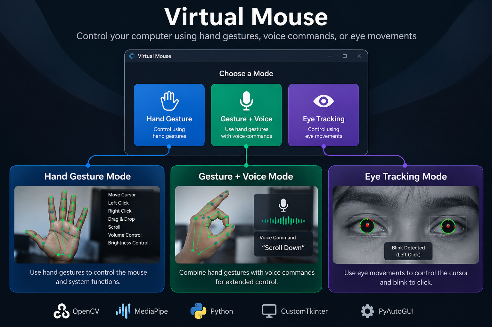

# Virtual Mouse & Gesture Control System

A webcam-based human–computer interaction project that lets you control selected mouse and system actions using **hand gestures, voice commands, and eye tracking**.



## Modes at a glance

The application opens a CustomTkinter mode selector. Choose one of the three available modes to start the corresponding controller.

| Mode | Input | What it does |
|---|---|---|
| **Hand Gesture** | Webcam + hand movements | Moves the cursor and performs mouse actions; supports scrolling and pinch-based system adjustments |
| **Gesture + Voice** | Webcam + microphone | Combines hand tracking with spoken mouse and scrolling commands |
| **Eye Tracking** | Webcam + facial/iris landmarks | Moves the cursor using iris position and uses a blink-like eye movement for clicking |

## Features

### 1. Hand Gesture Mode

Uses **MediaPipe Hands** to detect hand landmarks and interpret finger configurations.

- Cursor movement using hand position
- Left click, right click, and double click
- Click-and-drag interaction
- Vertical and horizontal scrolling
- Pinch-based brightness and volume adjustment

### 2. Gesture + Voice Mode

Combines the hand-gesture controller with speech recognition.

The voice commands implemented in the code include:

- "Left click"
- "Right click"
- "Double click"
- "Scroll up"
- "Scroll down"
- "Increase volume"
- "Decrease volume"

**Note:** The increase/decrease volume voice commands currently need a code fix: the command handler passes an `increase` argument to a volume method that does not accept it. Voice recognition also uses Google's online speech-recognition service, so an internet connection is required for that part.

### 3. Eye Tracking Mode

Uses **MediaPipe Face Mesh** with refined landmarks to estimate iris position.

- Cursor movement based on iris position
- Blink-like eye movement detection for clicking

## How it works

1. The mode selector lets the user choose a control mode.
2. OpenCV captures frames from the webcam.
3. MediaPipe extracts hand or facial landmarks.
4. The application interprets landmark positions as gestures or eye movements.
5. PyAutoGUI translates the detected input into mouse actions; system controls are handled through the relevant Windows libraries.

## Project structure

```text
Virtual-Mouse-Gesture/
├── Final.py                  # Main application and all three modes
├── README.md                 # Project documentation
├── hand_image.png            # Hand Gesture mode selector image
├── hand_voice_image.png      # Gesture + Voice mode selector image
├── eye_image.png             # Eye Tracking mode selector image
└── virtual-mouse-overview.png # Project overview image
```

## Tech stack

| Technology | Purpose |
|---|---|
| Python | Main application logic |
| OpenCV | Webcam capture and image processing |
| MediaPipe | Hand, face, and iris landmark detection |
| PyAutoGUI | Mouse and keyboard automation |
| CustomTkinter | Mode-selection interface |
| SpeechRecognition | Voice-command recognition |
| PyAudio | Microphone input for speech recognition |
| Pycaw | Windows audio-volume control |
| Screen Brightness Control | Display-brightness adjustment |

## Installation

### Prerequisites

- Python installed and available from the command line
- A working webcam
- A microphone for Gesture + Voice Mode
- Windows is the intended environment for the current implementation because it uses Windows-oriented audio and brightness-control libraries
- An internet connection for Google's speech-recognition service in Gesture + Voice Mode

### 1. Clone the repository

```bash
git clone https://github.com/4M5/Virtual-Mouse-Gesture.git
cd Virtual-Mouse-Gesture
```

### 2. Create and activate a virtual environment

**Windows (Command Prompt):**

```bash
python -m venv .venv
.venv\\Scripts\\activate
```

**macOS / Linux (environment setup only):**

```bash
python3 -m venv .venv
source .venv/bin/activate
```

> The application itself is not currently documented as cross-platform; its system-control dependencies are Windows-oriented.

### 3. Install dependencies

```bash
python -m pip install --upgrade pip
pip install opencv-python mediapipe PyAutoGUI customtkinter SpeechRecognition PyAudio pycaw comtypes screen-brightness-control
```

If PyAudio fails to install, use an installation method compatible with your Python version and operating system. PyAudio is needed for microphone input; without it, the voice mode cannot access the microphone.

### 4. Run the application

Run the command from the repository root so the mode-selector image files can be found:

```bash
python Final.py
```

Select **Gesture Mode**, **Gesture & Voice Mode**, or **Eye Mode** in the startup window.

## Usage and safety notes

- Keep your hand and face visible to the webcam and use adequate lighting.
- Allow microphone access before using Gesture + Voice Mode.
- Mouse actions are executed on your actual desktop. Close or save important work before testing.
- The current hand-control modes disable PyAutoGUI's corner failsafe. Use caution when testing because moving the pointer to a screen corner will not provide the usual PyAutoGUI failsafe stop.
- In the current implementation, the hand-control windows can be exited with **Enter**. Eye Tracking Mode currently has no dedicated keyboard exit condition; this should be improved before relying on it for extended use.

## Current implementation notes

This repository contains a consolidated application in `Final.py`; the three mode functions and the CustomTkinter selector are defined in that file. The image assets are loaded by the selector at startup.

Known items to improve:

- Fix the voice-mode volume command/function argument mismatch.
- Move voice listening to a background worker so microphone listening does not block webcam frame processing.
- Add a reliable quit key and camera/Face Mesh cleanup to Eye Tracking Mode.
- Restore or provide a safer alternative to disabling PyAutoGUI's failsafe.
- Add a dependency file with tested package versions once the development environment is confirmed.

## Future improvements

- Non-blocking voice recognition and more robust command handling
- Configurable gesture mappings and cursor sensitivity
- Calibration and smoothing for eye tracking
- Graceful exit handling and resource cleanup across all modes
- Dependency version pinning and cross-platform support

---

**Project:** [Virtual Mouse & Gesture Control System](https://github.com/4M5/Virtual-Mouse-Gesture)
